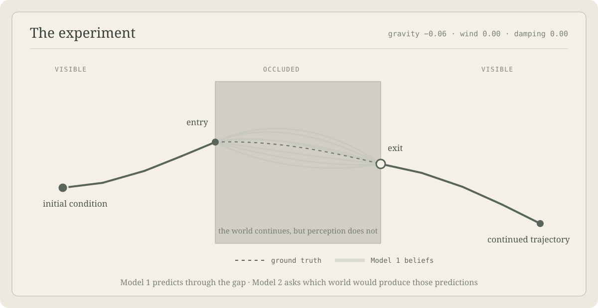

# Empathy

Empathy asks whether one system can partially recover another **as a perceiver**, through the intentional structure preserved in its experience. **Model 1 sees; Model 2 thinks by imagining the world that could have made Model 1 see as it did.**

## Environment

A ball moves behind a fixed occluder. Gravity, wind, and damping define one world and remain fixed while repeated throws vary the ball's initial height. The simulator supplies visible pixels before and after the gap; its hidden path is retained only as ground truth for the demonstration.



_One fixed world, many throws: Model 1 predicts through the occlusion; Model 2 searches for the world that would produce those beliefs._

## The thought experiment

Model 1 learns to predict the motion of an occluded object without being given explicit physical rules. Model 2 does not receive the true world parameters, the hidden trajectory, or Model 1's training targets. Its only perceptual input is one detached three-part packet from Model 1: the visible-before activation, Model 1's superposition of predicted hidden trajectories, and the visible-after activation. Event and checkpoint identifiers are used only to align comparisons.

Model 2 maintains candidate values for gravity, wind, and damping. For each candidate, it runs a counterfactual simulation and passes the resulting clip through a frozen copy of the current Model 1. Candidates whose activations resemble Model 1's observed response receive more posterior weight.

The experiment asks whether a perceptual model's internal response contains enough structure to recover the constraints of its environment. Here, coherence means that worlds which reproduce Model 1's response also approach the hidden physical parameters. “Empathy” names this limited form of second-order inference; it is not a claim about human-like empathy.

## Model 1: Seeing

Seeing is a small continual video world model. A shared 3D CNN encodes the visible approach together with the measured entry state and a fast latent for the current world. It produces the mean and scale of a distribution over GRU states. Samples from that distribution predict acceleration, update velocity, and integrate position one physical time step at a time, forming the visible fan of possible hidden trajectories.

When the ball reappears, its visible exit position, exit velocity, and first departure points score the frozen pre-exit samples. A single evidence loss updates the fast world latent and, more slowly, the shared CNN and GRU; a short replay buffer revisits recent throws. The hidden simulator trajectory never enters this loss.

## Model 2: Thinking

Thinking is currently an explicit inference process, not a second trained CNN. After each throw it receives a new frozen Seeing checkpoint and the three-part packet described above. The middle term contains all of Seeing's sampled hidden rollouts, interpolated onto one fixed time grid. The before and after activations provide context and normalization; the predicted hidden region is the primary inference signal. Thinking never receives the actual frames, hidden path, or true world parameters.

Sequential Monte Carlo maintains a persistent population of candidate values for gravity, wind, and damping. For every candidate, a private imagination runner executes the complete toy simulator, renders a counterfactual clip, and passes that clip through the same frozen Seeing checkpoint. Candidate videos are batched, but only their detached activation packets cross back into Thinking.

Worlds are weighted by component-normalized distance between the observed packet and the packet produced by the counterfactual Seeing run. The hidden-rollout term receives the primary weight; the two visible endpoint terms act as lower-weight anchors. The posterior persists across throws, resampling and gently revising hypotheses when its effective population becomes too small. The interface displays the posterior mean, marginal ranges, and a few joint possible worlds rather than pretending that one trajectory uniquely identifies the rules.

Seeing and Thinking run asynchronously. Seeing continues learning from the real stream; Thinking periodically receives increasingly recent frozen checkpoints and searches against each without blocking the animation. Seeing never learns which candidates Thinking considered and is never optimized to make their recovery easy.

This separation is the point of the toy: Seeing predicts what could happen; Thinking asks what kind of world would make those predictions and revisions take that form.

## Coherence

The system is coherent when candidate worlds that reproduce Seeing's internal response also approach the hidden world's constraints. The demo makes that test visible by placing the true parameter markers behind Thinking's posterior. Useful measurements are parameter error, posterior concentration, and stability across varied entry heights and held-out worlds.

The experiment is therefore about identifiability as much as accuracy. Different operator combinations can explain one exit; varied throws should eliminate some combinations while preserving genuine alternatives. Success means the activation space retains reusable information about forces rather than memorizing a trajectory template.

The shattering connection remains a capacity question rather than a claim made by the live demo: how many independent distinctions among possible worlds can survive in Seeing's states and be recovered by Thinking before coherence breaks down?

## Run

```bash
uv run empathy
```

Open <http://127.0.0.1:8765/explorer.html>.
